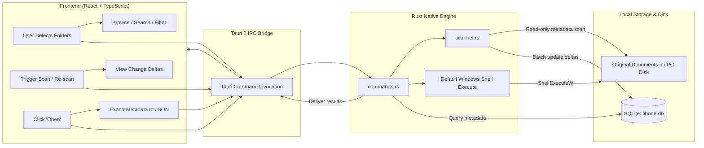

# LibOne Architecture & Phase 1 Foundation

LibOne is a local-first desktop document library for Windows. It provides a non-destructive library layer over documents where they already live, indexing them in place without moving, renaming, altering, or uploading them.

---

## 1. System Overview & Technology Stack

- **Desktop Shell**: [Tauri 2](https://v2.tauri.app/) (Rust core with Windows WebView2 integration)
- **Frontend**: React 19 + TypeScript + Vite
- **Backend / Engine**: Rust native application layer
- **Local Persistence**: Embedded SQLite (`rusqlite` WAL mode) stored in Windows AppData
- **Primary OS Target**: Windows 10 / 11 (64-bit)

---

## 2. Folder Structure

```text
LibOne/
├── .gitignore                    # Ignores Node, Rust target, Tauri gen, and local SQLite data
├── README.md                     # Product overview, core workflow, and development guide
├── ARCHITECTURE.md               # Architecture, data flow, boundaries, and data locations
├── index.html                    # Vite entry HTML
├── package.json                  # Frontend dependencies and dev scripts
├── tsconfig.json                 # TypeScript compiler configuration
├── tsconfig.node.json            # Vite build TypeScript config
├── vite.config.ts                # Vite config tailored for Tauri IPC and HMR
├── public/                       # Static public assets (icons, logos)
├── src/                          # Frontend React/TypeScript application
│   ├── assets/                   # UI assets
│   ├── services/
│   │   └── api.ts                # Typed Tauri IPC wrappers with browser dev fallbacks
│   ├── types.ts                  # Shared data interfaces (ScanRoot, IndexedFile, etc.)
│   ├── App.css                   # Calm, local-first Windows desktop design system
│   ├── App.tsx                   # Main desktop application interface (Phase 1)
│   ├── main.tsx                  # React DOM root entry
│   └── vite-env.d.ts             # Vite client types
└── src-tauri/                    # Rust native backend
    ├── Cargo.toml                # Rust dependencies (tauri, rusqlite, walkdir, sha2, chrono)
    ├── build.rs                  # Tauri build hook
    ├── tauri.conf.json           # Window configuration, capabilities, and plugin bindings
    ├── capabilities/
    │   └── default.json          # Security capabilities (core, opener, dialog)
    ├── icons/                    # Windows application icons (ico, png)
    └── src/
        ├── main.rs               # Win32 binary entry point
        ├── lib.rs                # Tauri runtime initialization, state, and command bindings
        ├── models.rs             # Core data structures (ScanRoot, IndexedFile, ScanStats, Export)
        ├── db.rs                 # SQLite schema initialization, migrations, and CRUD operations
        ├── scanner.rs            # Recursive in-place file scanner and change detection
        └── commands.rs           # Tauri IPC commands invoked by the React UI
```

---

## 3. Local Data Location

LibOne never stores your documents in an opaque vault or uploads them to any server. File metadata and scan configurations are stored strictly on the local machine:

- **Windows Standard Path**:  
  `%APPDATA%\com.libone.app\libone.db`  
  (Resolves dynamically via Tauri's `app.path().app_data_dir()`)
- **Storage Engine**: SQLite in Write-Ahead Logging (`WAL`) mode with `NORMAL` synchronous writes for crash resilience and zero file locking.
- **Migrations**: The Rust `Database` repository applies versioned migrations inside a single SQLite transaction. `schema_migrations` records the applied version; `library_metadata` stores the library's schema version and creation time. A legacy pre-migration schema is renamed and copied forward rather than discarded.
- **Tables**:
  - `scan_roots`: user-selected absolute and normalized paths, display name, enabled state, creation time, and scan lifecycle timestamps/status.
  - `indexed_files`: metadata only—absolute/normalized path, file name/type, size, available filesystem dates, discovery/last-seen dates, optional hash, and lifecycle status. Original file contents are never copied into SQLite.
  - `library_metadata`: one local-library record containing schema and creation information.

---

## 4. End-to-End Data Flow



1. **Folder Selection**: User chooses folders via native Windows folder picker (`tauri-plugin-dialog`) or path input.
2. **In-Place Scanning**: `scanner.rs` traverses folders recursively via `walkdir` without following symlinks. It reads standard filesystem metadata only. SQL is kept exclusively in `db.rs`, the repository layer.
3. **Change Detection**:
   - **New file**: Recorded as `active`.
   - **Timestamp/size change**: Updated and marked `modified`.
   - **Identical signature at new path with missing old path**: Detected as `moved`.
   - **Missing from disk**: Flagged as `missing` (never deleted from index without user consent).
4. **Opening Originals & Revealing Files**:
   - **Path Authorization**: Before opening or revealing any file, LibOne verifies that the file record exists in SQLite, belongs to an enabled scan root, and is strictly within authorized scan root boundaries.
   - **Non-Shell Execution**: LibOne never executes files via `cmd.exe` or shell command string interpolation. On Windows, it invokes native Win32 `ShellExecuteW` directly to launch the default registered handler, and spawns `explorer.exe /select,"<path>"` via direct argument passing without shell interpolation.
   - **Unavailable / Missing Handling**: If an indexed document no longer exists on disk, LibOne updates its status to `missing` and returns a descriptive explanation instead of failing silently.
5. **Metadata Export**: Complete snapshot serialized to a standardized, self-contained JSON schema.

---

## 5. Phase 1 Boundaries & Guarantees

Phase 1 focuses exclusively on the **Local Library Foundation**:

- **Read-Only File Safety**: LibOne never moves, renames, writes, alters, or deletes original files on disk.
- **Zero Cloud / Zero Network**: No external API calls, cloud storage, telemetry, analytics, user accounts, or background phone-homes.
- **No AI / Cloud Processing in Phase 1**: All indexing and change detection operate deterministically on the local CPU.
- **Safe Export**: Users can export their complete library database to portable JSON at any time.

---

## 6. Scanner Design, File Identity & Honest Limitations

### 6.1 Fast Change Detection
LibOne uses a tiered, metadata-first change detection strategy:
1. **Path Normalization**: Canonical lowercase paths with uniform Windows backslashes (`\`) ensure case-insensitive Windows filesystem lookups match reliably.
2. **Fast Metadata Check**: When traversing, LibOne inspects file size in bytes and filesystem modification timestamp (`mtime`).
   - If path, size, and timestamp match: marked `indexed` (unchanged), and `last_seen_at` is updated via a lightweight SQL touch.
   - If size or timestamp differs: marked `changed`, metadata updated, and content hash invalidated if not recomputed.

### 6.2 Windows Stable File Identity (NTFS & ReFS)
To track files across renames and moves within a scan root without reading file contents:
- On Windows systems supporting `BY_HANDLE_FILE_INFORMATION`, LibOne extracts the 32-bit volume serial number and 64-bit file index via Rust's `std::os::windows::fs::MetadataExt`.
- Stored as `"{vol:08x}:{idx:016x}"` in `indexed_files.file_id_nullable` (indexed in SQLite Schema version 2).
- When a file disappears from path A and appears at path B with the same file ID, LibOne updates the existing row in place (preserving historical discovery time, tags, and notes).

### 6.3 Move & Rename Detection Priority
1. **File ID Match**: When the file ID matches an existing record in the scan root that has not yet been matched at its old path, the file is recognized as moved/renamed.
2. **Unambiguous Fallback**: On filesystems where file IDs are not available (e.g., FAT32, exFAT, network shares), LibOne looks for exactly **one** unmatched record with the identical filename, size, and modified time. If exactly one candidate exists, it is linked as a move.
3. **Safe Fallback**: If multiple candidates exist or no match is found, the file is indexed as a new record and the old file is marked `missing` after the scan completes.

### 6.4 Status Model
- `indexed`: Present on disk and unchanged since last scan.
- `changed`: Present on disk, but size or modification time differs from the stored record.
- `missing`: Was previously indexed, but no longer found on disk at the recorded path. Historical records remain intact and are never deleted without explicit user confirmation.
- `inaccessible`: Path exists on disk but could not be read during traversal (permission denied, locked by another application).
- `error`: Failed during traversal due to I/O error or filesystem corruption.

### 6.5 Optional Streaming SHA-256 Hashing
- **Never loads whole documents into memory**: SHA-256 is calculated using a fixed 64 KB streaming buffer (`std::io::Read` into `sha2::Sha256`).
- **Opt-in Only**: Regular scans skip content hashing for maximum speed (scanning thousands of files in milliseconds). Hashing can be enabled per-scan via `ScanOptions { compute_hashes: true }` or on-demand for individual files via `compute_file_hash`.

### 6.6 Honest Limitations
1. **Non-NTFS Filesystems**: FAT32, exFAT, and some SMB/CIFS network shares do not expose persistent 64-bit file indices. On these volumes, LibOne relies on unambiguous name+size+mtime heuristics; complex simultaneous rename+edits will be treated as new files with the old record marked missing.
2. **Cross-Root Moves**: Rename and move tracking is scoped to the containing scan root. Moving a file from `D:\Documents` (Root 1) to `E:\Archive` (Root 2) will mark the file missing in Root 1 and new in Root 2.
3. **External Editors that Replace via Delete+Create**: Some text editors save files by writing to a temporary file, deleting the original, and renaming the temporary file into place. On NTFS, this may generate a new file ID. The scanner handles this via normalized path matching if the destination path remains the same.
4. **Cooperative Cancellation**: Scans check atomic cancellation tokens between directory entries. Cancelling a scan halts further traversal and preserves all records indexed up to that point; files in unvisited subtrees are left untouched and are **not** marked missing.

---

## 7. Library Access API & Security Design

### 7.1 Paginated File Listing & Query Engine
The SQLite repository layer provides `query_files` with parameterized SQL:
- **Pagination**: Returns fixed-size chunks using SQL `LIMIT ? OFFSET ?`, accompanied by total count calculations (`COUNT(*)`) and total page computation.
- **Sorting**: Validates sort keys against a strict whitelist (`name`, `path`, `extension`, `size`, `modified`, `status`) to prevent SQL injection, appending direction (`ASC` / `DESC`).
- **Filtering**: Combines scan root restrictions (`scan_root_id`), format restrictions (`extension`), lifecycle status filters (`status`), and multi-field substring queries (`file_name`, `absolute_path`, `extension`).
- **Format Discovery**: `get_distinct_extensions` queries distinct non-empty file extensions to populate UI filter dropdowns dynamically.

### 7.2 Path Authorization Pipeline
Before opening or revealing any original document on disk, LibOne runs `validate_file_for_access`:
1. **Index Existence**: Ensures the target record exists in SQLite. Rejects arbitrary unindexed file paths.
2. **Scan Root Authorization**: Ensures the containing scan root exists and is marked `enabled`. Disabling a folder instantly blocks opening documents from it.
3. **Boundary Verification**: Verifies the normalized file path starts with the normalized scan root path, preventing directory traversal or symlink escapes.
4. **On-Disk Verification**: Checks that the file exists on disk. If the file has disappeared, LibOne updates its SQLite status to `missing` and returns a descriptive error explanation.
5. **Regular File Verification**: Rejects directories, junctions, or device targets.

### 7.3 Non-Shell Execution Guarantee
To guarantee safety and prevent command injection or execution of malicious batch scripts:
- **Default Application Launching**: On Windows, LibOne calls native Win32 `ShellExecuteW(NULL, L"open", wide_path, NULL, NULL, SW_SHOWNORMAL)` from `shell32.dll`. This directly resolves the registered default application without invoking `cmd.exe`, PowerShell, or any shell wrapper.
- **Show in File Explorer**: Uses direct process creation via `explorer.exe /select,"<file_path>"`. If the file is missing, LibOne attempts to reveal the containing folder while notifying the user.

### 7.4 Document Privacy
- LibOne displays and queries filesystem metadata only (paths, sizes, dates, hashes, status).
- Document contents are never loaded into memory for previewing, and are never transmitted across IPC or external networks.

---

## 8. File-System Watcher & Live Sync Architecture

### 8.1 Watcher Lifecycle
- **Active only while running**: File-system watching runs strictly within the LibOne process lifetime using the `notify` (v6.1) crate backed by Windows `ReadDirectoryChangesW`.
- **Dynamic root management**: On application startup, LibOne queries all `enabled` scan roots and registers watchers.
  - Enabling or adding a scan root starts its watcher thread immediately.
  - Disabling or removing a scan root aborts its watcher thread and releases Windows file-system handles.
  - When LibOne shuts down, dropping `WatcherManager` cleanly terminates all watcher threads.
- **Independence from manual scanning**: Watcher failures are isolated; manual scans remain fully functional regardless of watcher health.

### 8.2 Event Coalescing & Debouncing
- High-frequency file operations (e.g., git checkouts, compiling, downloading, multi-file extract) can generate hundreds of events per second.
- LibOne uses an event coalescing loop with two thresholds:
  1. **500 ms Quiet Window**: After receiving a file-system event, LibOne waits 500 ms for subsequent events to settle.
  2. **2,500 ms Maximum Window**: If events continue arriving indefinitely, a refresh triggers after 2.5 seconds to prevent starvation.
- While coalescing, the UI displays a subtle `Syncing changes…` indicator. Once coalescing finishes, a refresh executes in the background and emits a `library-updated` event so the frontend refreshes automatically.

### 8.3 Targeted Refresh vs. Rescan Fallback
When coalescing completes, LibOne determines the safest refresh strategy:
1. **Targeted Refresh**:
   - Used when the batch contains **<= 50 regular file changes** and no directory modifications.
   - **Created/Modified**: Inspects file metadata on disk (size, modified time, NTFS file ID) and updates the database row incrementally.
   - **Deleted**: Safely updates the SQLite file status to `missing` rather than deleting the historical record.
   - **Renamed**: Correlates the old and new file paths via NTFS file identity (`BY_HANDLE_FILE_INFORMATION`). If matched, the existing record is updated in place.
2. **Safe Rescan Fallback**:
   - Triggered when:
     - The event batch contains more than 50 files.
     - A directory was created, renamed, or deleted.
     - The OS buffer experienced an overflow or ambiguous event sequence.
   - Calls the core incremental scanner (`scanner::scan_folder_with_progress`), cleanly reconciling the root in SQLite.

### 8.4 Boundary Safety & Exclusion Rules
- **Symlinks & Junctions**: Excluded from event processing. Events originating from reparse points outside the target root are rejected.
- **Ignored Directories**: Ignores changes within `.git`, `node_modules`, `target`, `dist`, `build`, and LibOne's own AppData database directory.
- **Temporary Files**: Ignores common Office locking and temporary swap files (`~$*`, `*.tmp`, `*.swp`).

### 8.5 Honest Watcher Limitations
1. **Network Shares (SMB/CIFS)**: Depending on server configuration and Windows client cache settings, remote network shares may fail to emit `ReadDirectoryChangesW` events. Users should use manual scans for network locations.
2. **Drive Unmounting**: If an external USB drive or secondary hard drive is detached while LibOne is watching it, the OS watcher emits an I/O error. LibOne catches this, records the error in the per-root status, and displays a non-intrusive warning badge in the UI without crashing.
3. **Atomic Replace Patterns**: When editors create a temporary file, delete the target, and rename the temporary file over the target, intermediate delete events can be coalesced with create events. The debounce window minimizes transient flickers, but rapid successive saves may momentarily appear as a new record if NTFS assigns a fresh file ID.
4. **Coalesce Latency**: File changes are deliberately delayed by 500 ms to preserve CPU and battery life on laptop devices.

---

## 9. Portable Metadata Export Architecture

### 9.1 Self-Contained Versioned Snapshot
- **Format Version `1.0.0`**: Exports carry a dedicated `format_version` attribute conforming to semantic versioning guidelines documented in `EXPORT_FORMAT.md`.
- **Complete Library Metadata**: Includes top-level application metadata, aggregate summaries (`total_roots`, `total_files`, `total_size_bytes`), complete scan root definitions, and all indexed document file entries with their statuses, timestamps, sizes, NTFS identities, and computed hashes.
- **Strictly No Document Content**: Under no circumstances does the export engine read or embed file payload bytes. The original documents remain completely untouched on disk.

### 9.2 Validation Pipeline
Before serializing or persisting any export to disk, the backend runs `validate_export`:
1. **Header Checks**: Asserts that `format_version`, `app`, `version`, and `exported_at` are present and non-empty.
2. **Integrity Validation**: Verifies that `summary.total_roots == scan_roots.len()` and `summary.total_files == files.len()`.
3. If any assertion fails, the operation aborts before performing filesystem writes, returning a clear error to the UI.

### 9.3 Atomic Safe-Write Guarantee
Writing metadata snapshots can fail if the user disconnects a drive, runs out of disk space, or encounters a power disruption. To prevent partial or corrupt JSON files:
- The backend writes the serialized JSON to a hidden sibling file (`.libone-export-<nanos>.tmp`) located in the same target folder.
- Once the write completes successfully, LibOne performs an atomic filesystem rename (`std::fs::rename`) into the final target filename.
- If writing or renaming fails, the temporary file is removed immediately and the original file (if one existed) remains intact.

### 9.4 Local Storage Transparency & Settings
- The application exposes a dedicated **Settings & Library Storage** screen detailing:
  - Exact path to the local SQLite database (`<AppData>\libone.db`).
  - Path to the application data root directory.
  - Active operating system and version.
  - Architecture guarantees: original files remain read-only; zero cloud synchronization or external uploads; metadata-only index.
- No cloud backups, background synchronization, or automatic external transmissions are implemented. Users retain complete local custody over all data.


