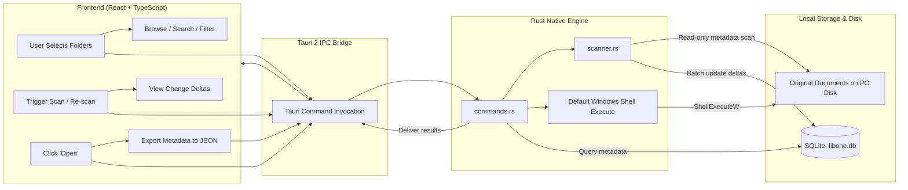

# LibOne Architecture & Phase 1 Foundation

LibOne is a local-first desktop document library for Windows. It provides a non-destructive library layer over documents where they already live, indexing them in place without moving, renaming, altering, or uploading them.

---

## 1. System Overview & Technology Stack

- **Desktop Shell**: [Tauri 2](https://v2.tauri.app/) (Rust core with Windows WebView2 integration)
- **Frontend**: React 19 + TypeScript + Vite
- **Backend / Engine**: Rust native application layer
- **Local Persistence**: Embedded SQLite (`rusqlite` WAL mode) stored in Windows AppData
- **Primary OS Target**: Windows 10 / 11 (64-bit)

---

## 2. Folder Structure

```text
LibOne/
├── .gitignore                    # Ignores Node, Rust target, Tauri gen, and local SQLite data
├── README.md                     # Product overview, core workflow, and development guide
├── ARCHITECTURE.md               # Architecture, data flow, boundaries, and data locations
├── index.html                    # Vite entry HTML
├── package.json                  # Frontend dependencies and dev scripts
├── tsconfig.json                 # TypeScript compiler configuration
├── tsconfig.node.json            # Vite build TypeScript config
├── vite.config.ts                # Vite config tailored for Tauri IPC and HMR
├── public/                       # Static public assets (icons, logos)
├── src/                          # Frontend React/TypeScript application
│   ├── assets/                   # UI assets
│   ├── services/
│   │   └── api.ts                # Typed Tauri IPC wrappers with browser dev fallbacks
│   ├── types.ts                  # Shared data interfaces (ScanRoot, IndexedFile, etc.)
│   ├── App.css                   # Calm, local-first Windows desktop design system
│   ├── App.tsx                   # Main desktop application interface (Phase 1)
│   ├── main.tsx                  # React DOM root entry
│   └── vite-env.d.ts             # Vite client types
└── src-tauri/                    # Rust native backend
    ├── Cargo.toml                # Rust dependencies (tauri, rusqlite, walkdir, sha2, chrono)
    ├── build.rs                  # Tauri build hook
    ├── tauri.conf.json           # Window configuration, capabilities, and plugin bindings
    ├── capabilities/
    │   └── default.json          # Security capabilities (core, opener, dialog)
    ├── icons/                    # Windows application icons (ico, png)
    └── src/
        ├── main.rs               # Win32 binary entry point
        ├── lib.rs                # Tauri runtime initialization, state, and command bindings
        ├── models.rs             # Core data structures (ScanRoot, IndexedFile, ScanStats, Export)
        ├── db.rs                 # SQLite schema initialization, migrations, and CRUD operations
        ├── scanner.rs            # Recursive in-place file scanner and change detection
        └── commands.rs           # Tauri IPC commands invoked by the React UI
```

---

## 3. Local Data Location

LibOne never stores your documents in an opaque vault or uploads them to any server. File metadata and scan configurations are stored strictly on the local machine:

- **Windows Standard Path**:  
  `%APPDATA%\com.libone.app\libone.db`  
  (Resolves dynamically via Tauri's `app.path().app_data_dir()`)
- **Storage Engine**: SQLite in Write-Ahead Logging (`WAL`) mode with `NORMAL` synchronous writes for crash resilience and zero file locking.
- **Migrations**: The Rust `Database` repository applies versioned migrations inside a single SQLite transaction. `schema_migrations` records the applied version; `library_metadata` stores the library's schema version and creation time. A legacy pre-migration schema is renamed and copied forward rather than discarded.
- **Tables**:
  - `scan_roots`: user-selected absolute and normalized paths, display name, enabled state, creation time, and scan lifecycle timestamps/status.
  - `indexed_files`: metadata only—absolute/normalized path, file name/type, size, available filesystem dates, discovery/last-seen dates, optional hash, and lifecycle status. Original file contents are never copied into SQLite.
  - `library_metadata`: one local-library record containing schema and creation information.

---

## 4. End-to-End Data Flow



1. **Folder Selection**: User chooses folders via native Windows folder picker (`tauri-plugin-dialog`) or path input.
2. **In-Place Scanning**: `scanner.rs` traverses folders recursively via `walkdir` without following symlinks. It reads standard filesystem metadata only. SQL is kept exclusively in `db.rs`, the repository layer.
3. **Change Detection**:
   - **New file**: Recorded as `active`.
   - **Timestamp/size change**: Updated and marked `modified`.
   - **Identical signature at new path with missing old path**: Detected as `moved`.
   - **Missing from disk**: Flagged as `missing` (never deleted from index without user consent).
4. **Opening Originals**: Windows default application handler executes the original path in-place using Windows shell commands (`cmd /c start "" "<path>"`).
5. **Metadata Export**: Complete snapshot serialized to a standardized, self-contained JSON schema.

---

## 5. Phase 1 Boundaries & Guarantees

Phase 1 focuses exclusively on the **Local Library Foundation**:

- **Read-Only File Safety**: LibOne never moves, renames, writes, alters, or deletes original files on disk.
- **Zero Cloud / Zero Network**: No external API calls, cloud storage, telemetry, analytics, user accounts, or background phone-homes.
- **No AI / Cloud Processing in Phase 1**: All indexing and change detection operate deterministically on the local CPU.
- **Safe Export**: Users can export their complete library database to portable JSON at any time.

---

## 6. Scanner Design, File Identity & Honest Limitations

### 6.1 Fast Change Detection
LibOne uses a tiered, metadata-first change detection strategy:
1. **Path Normalization**: Canonical lowercase paths with uniform Windows backslashes (`\`) ensure case-insensitive Windows filesystem lookups match reliably.
2. **Fast Metadata Check**: When traversing, LibOne inspects file size in bytes and filesystem modification timestamp (`mtime`).
   - If path, size, and timestamp match: marked `indexed` (unchanged), and `last_seen_at` is updated via a lightweight SQL touch.
   - If size or timestamp differs: marked `changed`, metadata updated, and content hash invalidated if not recomputed.

### 6.2 Windows Stable File Identity (NTFS & ReFS)
To track files across renames and moves within a scan root without reading file contents:
- On Windows systems supporting `BY_HANDLE_FILE_INFORMATION`, LibOne extracts the 32-bit volume serial number and 64-bit file index via Rust's `std::os::windows::fs::MetadataExt`.
- Stored as `"{vol:08x}:{idx:016x}"` in `indexed_files.file_id_nullable` (indexed in SQLite Schema version 2).
- When a file disappears from path A and appears at path B with the same file ID, LibOne updates the existing row in place (preserving historical discovery time, tags, and notes).

### 6.3 Move & Rename Detection Priority
1. **File ID Match**: When the file ID matches an existing record in the scan root that has not yet been matched at its old path, the file is recognized as moved/renamed.
2. **Unambiguous Fallback**: On filesystems where file IDs are not available (e.g., FAT32, exFAT, network shares), LibOne looks for exactly **one** unmatched record with the identical filename, size, and modified time. If exactly one candidate exists, it is linked as a move.
3. **Safe Fallback**: If multiple candidates exist or no match is found, the file is indexed as a new record and the old file is marked `missing` after the scan completes.

### 6.4 Status Model
- `indexed`: Present on disk and unchanged since last scan.
- `changed`: Present on disk, but size or modification time differs from the stored record.
- `missing`: Was previously indexed, but no longer found on disk at the recorded path. Historical records remain intact and are never deleted without explicit user confirmation.
- `inaccessible`: Path exists on disk but could not be read during traversal (permission denied, locked by another application).
- `error`: Failed during traversal due to I/O error or filesystem corruption.

### 6.5 Optional Streaming SHA-256 Hashing
- **Never loads whole documents into memory**: SHA-256 is calculated using a fixed 64 KB streaming buffer (`std::io::Read` into `sha2::Sha256`).
- **Opt-in Only**: Regular scans skip content hashing for maximum speed (scanning thousands of files in milliseconds). Hashing can be enabled per-scan via `ScanOptions { compute_hashes: true }` or on-demand for individual files via `compute_file_hash`.

### 6.6 Honest Limitations
1. **Non-NTFS Filesystems**: FAT32, exFAT, and some SMB/CIFS network shares do not expose persistent 64-bit file indices. On these volumes, LibOne relies on unambiguous name+size+mtime heuristics; complex simultaneous rename+edits will be treated as new files with the old record marked missing.
2. **Cross-Root Moves**: Rename and move tracking is scoped to the containing scan root. Moving a file from `D:\Documents` (Root 1) to `E:\Archive` (Root 2) will mark the file missing in Root 1 and new in Root 2.
3. **External Editors that Replace via Delete+Create**: Some text editors save files by writing to a temporary file, deleting the original, and renaming the temporary file into place. On NTFS, this may generate a new file ID. The scanner handles this via normalized path matching if the destination path remains the same.
4. **Cooperative Cancellation**: Scans check atomic cancellation tokens between directory entries. Cancelling a scan halts further traversal and preserves all records indexed up to that point; files in unvisited subtrees are left untouched and are **not** marked missing.
