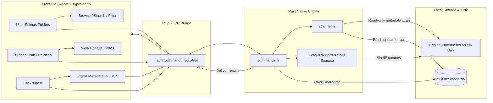

# LibOne Architecture & Phase 1 Foundation

LibOne is a local-first desktop document library for Windows. It provides a non-destructive library layer over documents where they already live, indexing them in place without moving, renaming, altering, or uploading them.

---

## 1. System Overview & Technology Stack

- **Desktop Shell**: [Tauri 2](https://v2.tauri.app/) (Rust core with Windows WebView2 integration)
- **Frontend**: React 19 + TypeScript + Vite
- **Backend / Engine**: Rust native application layer
- **Local Persistence**: Embedded SQLite (`rusqlite` WAL mode) stored in Windows AppData
- **Primary OS Target**: Windows 10 / 11 (64-bit)

---

## 2. Folder Structure

```text
LibOne/
├── .gitignore                    # Ignores Node, Rust target, Tauri gen, and local SQLite data
├── README.md                     # Product overview, core workflow, and development guide
├── ARCHITECTURE.md               # Architecture, data flow, boundaries, and data locations
├── index.html                    # Vite entry HTML
├── package.json                  # Frontend dependencies and dev scripts
├── tsconfig.json                 # TypeScript compiler configuration
├── tsconfig.node.json            # Vite build TypeScript config
├── vite.config.ts                # Vite config tailored for Tauri IPC and HMR
├── public/                       # Static public assets (icons, logos)
├── src/                          # Frontend React/TypeScript application
│   ├── assets/                   # UI assets
│   ├── services/
│   │   └── api.ts                # Typed Tauri IPC wrappers with browser dev fallbacks
│   ├── types.ts                  # Shared data interfaces (ScanRoot, IndexedFile, etc.)
│   ├── App.css                   # Calm, local-first Windows desktop design system
│   ├── App.tsx                   # Main desktop application interface (Phase 1)
│   ├── main.tsx                  # React DOM root entry
│   └── vite-env.d.ts             # Vite client types
└── src-tauri/                    # Rust native backend
    ├── Cargo.toml                # Rust dependencies (tauri, rusqlite, walkdir, sha2, chrono)
    ├── build.rs                  # Tauri build hook
    ├── tauri.conf.json           # Window configuration, capabilities, and plugin bindings
    ├── capabilities/
    │   └── default.json          # Security capabilities (core, opener, dialog)
    ├── icons/                    # Windows application icons (ico, png)
    └── src/
        ├── main.rs               # Win32 binary entry point
        ├── lib.rs                # Tauri runtime initialization, state, and command bindings
        ├── models.rs             # Core data structures (ScanRoot, IndexedFile, ScanStats, Export)
        ├── db.rs                 # SQLite schema initialization, migrations, and CRUD operations
        ├── scanner.rs            # Recursive in-place file scanner and change detection
        └── commands.rs           # Tauri IPC commands invoked by the React UI
```

---

## 3. Local Data Location

LibOne never stores your documents in an opaque vault or uploads them to any server. File metadata and scan configurations are stored strictly on the local machine:

- **Windows Standard Path**:  
  `%APPDATA%\com.libone.app\libone.db`  
  (Resolves dynamically via Tauri's `app.path().app_data_dir()`)
- **Storage Engine**: SQLite in Write-Ahead Logging (`WAL`) mode with `NORMAL` synchronous writes for crash resilience and zero file locking.
- **Tables**:
  - `scan_roots`: User-selected directories with timestamps and scanning status.
  - `files`: Indexed file metadata (original path, filename, extension, size, modified timestamp, SHA-256 prefix signature, lifecycle status).
  - `scan_history`: Audit record of scan runs and detected delta statistics.

---

## 4. End-to-End Data Flow



1. **Folder Selection**: User chooses folders via native Windows folder picker (`tauri-plugin-dialog`) or path input.
2. **In-Place Scanning**: `scanner.rs` traverses folders recursively via `walkdir` without following symlinks. It reads standard file metadata (size, modified time) and generates a fast SHA-256 prefix for fingerprinting.
3. **Change Detection**:
   - **New file**: Recorded as `active`.
   - **Timestamp/size change**: Updated and marked `modified`.
   - **Identical signature at new path with missing old path**: Detected as `moved`.
   - **Missing from disk**: Flagged as `missing` (never deleted from index without user consent).
4. **Opening Originals**: Windows default application handler executes the original path in-place using Windows shell commands (`cmd /c start "" "<path>"`).
5. **Metadata Export**: Complete snapshot serialized to a standardized, self-contained JSON schema.

---

## 5. Phase 1 Boundaries & Guarantees

Phase 1 focuses exclusively on the **Local Library Foundation**:

- **Read-Only File Safety**: LibOne never moves, renames, writes, alters, or deletes original files on disk.
- **Zero Cloud / Zero Network**: No external API calls, cloud storage, telemetry, analytics, user accounts, or background phone-homes.
- **No AI / Cloud Processing in Phase 1**: All indexing and change detection operate deterministically on the local CPU.
- **Safe Export**: Users can export their complete library database to portable JSON at any time.
