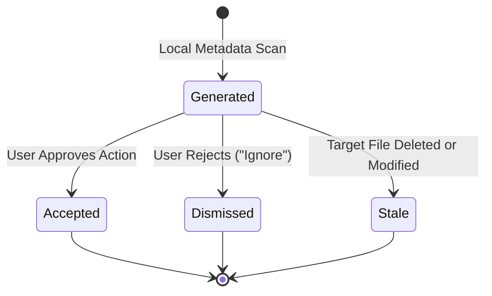

# LibOne Phase 3 Implementation Plan: Local Intelligent Organization & Suggestions Engine

**Objective**: Extend LibOne with a completely offline, deterministic, metadata-only analysis engine that discovers patterns across indexed files and proposes actionable suggestions (collection grouping, smart tags, exact and suspected duplicates, related file clusters, and index cleanup).

---

## 1. Architectural Guardrails & Strict Invariants

All core LibOne guarantees established in Phase 1 and Phase 2 remain absolute:

1. **100% Offline & Local-First**: Zero cloud APIs, remote servers, network requests, telemetry, background phone-homes, user accounts, or external services.
2. **Zero Modification to Original Files**: LibOne operates strictly in read-only mode over original documents. Phase 3 never creates, moves, renames, writes, alters, or deletes any file on disk.
3. **Explicit User Consent for All Actions**: Suggestions are non-binding recommendations. **No suggestion is ever automatically applied.** Every state change (creating a collection, assigning a tag, or clearing a missing record) requires an explicit user action and confirmation in the UI.
4. **Metadata-Only Analysis**: Analysis operates strictly on filesystem metadata (normalized paths, directory trees, file names, file extensions, sizes in bytes, timestamps, and on-demand SHA-256 digests) and LibOne database metadata (existing collections, tags, links, and scan roots). **Document file contents are never read, parsed, extracted, or OCR-processed.**
5. **Preservation of Phase 1 & 2 Behavior**: Existing scanning, NTFS identity tracking, filesystem watching, pagination, sorting, search, collection/tag CRUD, private notes, and export format v1.1.0 compatibility remain completely unchanged.
6. **Strict Architecture Boundary**:
   - Production SQL is confined exclusively to `src-tauri/src/db.rs` (Repository Layer).
   - Analysis algorithms and heuristics reside in a dedicated native module: `src-tauri/src/analyzer.rs`.
   - Tauri IPC commands in `src-tauri/src/commands.rs` validate all inputs and map requests to the database/analyzer.
   - Frontend UI invokes analysis and suggestions strictly through `src/services/api.ts`. No raw Tauri or database calls exist in React components.

---

## 2. Suggestion Categories & Heuristic Algorithms

The analyzer engine runs deterministically on local CPU threads, evaluating indexed files against five distinct categories:

### 2.1 Category 1: Collection Suggestions (`suggest_collection`)
- **Folder Clustering**: When a directory subtree inside an authorized scan root contains $\ge N$ documents (default $N = 3$) sharing a common parent folder (e.g., `Documents\Contracts\2025\*.pdf`), and $\le 20\%$ of those files belong to any existing collection, propose creating or associating with a Collection named after the folder (e.g., `"Contracts"`).
- **Naming Prefix / Suffix Pattern**: Files sharing a common normalized prefix or stem (e.g., `Tax_2023_*.pdf`, `Tax_2024_*.pdf`, `Tax_2025_*.pdf`) where at least 3 files exist without a shared collection.
- **Payload & Action**:
  - Suggested Collection Name (user-editable).
  - Target file IDs.
  - Explanation: *"Found 5 unorganized documents in folder 'Contracts'"*.

### 2.2 Category 2: Tag Suggestions (`suggest_tag`)
- **Temporal / Year Tokens**: File stems or directory path segments containing 4-digit years (e.g., `2023`, `2024`, `2025`, `2026`) matching regular date patterns.
- **Standard Document Types / Workflow Stems**: Recognizable keywords extracted from file basenames using delimiter tokenization (`_`, `-`, `.`, spaces):
  - Common semantic markers: `invoice`, `receipt`, `statement`, `draft`, `final`, `contract`, `resume`, `report`, `manual`, `tax`, `backup`.
- **Extension Categories**: Suggesting functional tags based on file format groups if not already tagged (e.g., `spreadsheet` for `.xlsx`, `.csv`, `.ods`; `document` for `.docx`, `.pdf`, `.odt`).
- **Deduplication against Existing Tags**: Matches existing tag names case-insensitively; if a tag already exists, suggests linking to the existing tag ID instead of creating a duplicate.

### 2.3 Category 3: Exact & Suspected Duplicates (`duplicate_content` & `duplicate_name_size`)
- **Exact Duplicates (Content Hash Match)**:
  - Trigger: Files sharing identical `size_bytes > 0` AND matching `content_hash_nullable` (computed SHA-256).
  - Confidence: 100% (Bit-for-bit identical content).
  - Explanation: *"Identical file content (SHA-256 verified) at 2 different paths"*.
- **Suspected Duplicates (Metadata Heuristic)**:
  - Trigger: Files with identical `file_name` (case-insensitive) and identical `size_bytes > 0`, but where SHA-256 has not yet been computed for both.
  - UI Option: Provide a 1-click on-demand *"Verify Hashes"* action that computes hashes for the suspect pair using the existing streaming `compute_file_hash` API before the user takes any organizational action.
- **Action Safe Guarantee**: LibOne **never** deletes duplicate files from disk. Instead, the user can tag them as `duplicate`, assign them to a `"Duplicate Review"` collection, or inspect their file paths side-by-side in Explorer.

### 2.4 Category 4: Related Files (`related_cluster`)
- **Multi-Format Companions**: Files sharing the exact same base stem in the same directory but with different extensions:
  - Examples: `quarterly_report.docx` and `quarterly_report.pdf`; `scan001.tif` and `scan001.pdf`; `data.csv` and `data.xlsx`.
- **Version Series Detection**: Files in the same folder with trailing version increments:
  - Pattern: `Proposal_v1.docx`, `Proposal_v2.docx`, `Proposal_final.docx`.
- **Action**: Suggests cross-linking the cluster under a unified collection or linking notes referencing the companion file.

### 2.5 Category 5: Library Cleanup Suggestions (`cleanup_candidate`)
- **Missing File Index Records**: Files with `status = 'missing'` that have not been seen for $\ge 30$ days or where the containing scan root has been rescanned multiple times.
  - Action: Proposes cleaning the historical index record from SQLite (with explicit confirmation that original disk files are unaffected).
- **Transient / Lock Files Accidentally Indexed**: Files matching transient patterns (`~$*`, `*.tmp`, `*.crdownload`, `.DS_Store`, `Thumbs.db`) that may have been created during an active traversal.
  - Action: Propose removing the index record and adding the pattern to ignore rules.
- **Empty / Inaccessible Stubs**: Files with `size_bytes == 0` or persistent `status = 'inaccessible'`.

---

## 3. Suggestion Lifecycle & State Machine

Suggestions have a dedicated lifecycle tracked in the SQLite database to ensure dismissed suggestions never re-appear to annoy the user, and applied suggestions have an audit trail:



### States:
1. `pending`: Freshly computed suggestion presented to the user.
2. `accepted`: User confirmed and applied the proposed changes.
3. `dismissed`: User explicitly ignored/rejected the suggestion. The fingerprint is stored so subsequent analyzer passes skip proposing it again.
4. `stale`: Files referenced by the suggestion were moved, modified, or missing before the suggestion was acted upon.

---

## 4. Database Schema Migration (Schema Version 4)

Additive migration applied transactionally in `src-tauri/src/db.rs` when `current < 4`:

```sql
-- 1. Table for persistent suggestions
CREATE TABLE IF NOT EXISTS suggestions (
    id INTEGER PRIMARY KEY AUTOINCREMENT,
    category TEXT NOT NULL CHECK(category IN ('suggest_collection', 'suggest_tag', 'duplicate_content', 'duplicate_name_size', 'related_cluster', 'cleanup_candidate')),
    title TEXT NOT NULL,
    description TEXT NOT NULL,
    confidence REAL NOT NULL CHECK(confidence >= 0.0 AND confidence <= 1.0),
    fingerprint TEXT NOT NULL UNIQUE, -- SHA-256 of normalized inputs to prevent duplicate proposals
    payload_json TEXT NOT NULL,       -- Serialized metadata (proposed collection name, tag name, file IDs, etc.)
    status TEXT NOT NULL DEFAULT 'pending' CHECK(status IN ('pending', 'accepted', 'dismissed', 'stale')),
    created_at TEXT NOT NULL,
    resolved_at TEXT
);

-- 2. Link table between suggestions and indexed files (for cascading checks & query joins)
CREATE TABLE IF NOT EXISTS suggestion_files (
    suggestion_id INTEGER NOT NULL REFERENCES suggestions(id) ON DELETE CASCADE,
    file_id INTEGER NOT NULL REFERENCES indexed_files(id) ON DELETE CASCADE,
    role TEXT NOT NULL DEFAULT 'target', -- 'primary', 'target', 'duplicate', 'companion'
    PRIMARY KEY (suggestion_id, file_id)
);

-- 3. Indexes for responsive filtering
CREATE INDEX IF NOT EXISTS idx_suggestions_status_category ON suggestions(status, category);
CREATE INDEX IF NOT EXISTS idx_suggestions_fingerprint ON suggestions(fingerprint);
CREATE INDEX IF NOT EXISTS idx_suggestion_files_file_id ON suggestion_files(file_id);

-- Version bump
INSERT INTO library_metadata(id, schema_version, library_created_at, updated_at)
VALUES(1, 4, CURRENT_TIMESTAMP, CURRENT_TIMESTAMP)
ON CONFLICT(id) DO UPDATE SET schema_version = 4, updated_at = CURRENT_TIMESTAMP;

INSERT INTO schema_migrations(version, applied_at) VALUES(4, CURRENT_TIMESTAMP);
```

---

## 5. Rust Data Models & IPC Commands

### 5.1 Models (`src-tauri/src/models.rs`)

```rust
#[derive(Debug, Clone, Serialize, Deserialize)]
pub struct Suggestion {
    pub id: i64,
    pub category: String, // "suggest_collection", "suggest_tag", etc.
    pub title: String,
    pub description: String,
    pub confidence: f64,
    pub fingerprint: String,
    pub payload: SuggestionPayload,
    pub status: String, // "pending", "accepted", "dismissed", "stale"
    pub files: Vec<IndexedFile>,
    pub created_at: String,
    pub resolved_at: Option<String>,
}

#[derive(Debug, Clone, Serialize, Deserialize)]
#[serde(tag = "type")]
pub enum SuggestionPayload {
    Collection {
        suggested_name: String,
        suggested_color: Option<String>,
        file_ids: Vec<i64>,
    },
    Tag {
        suggested_name: String,
        suggested_color: Option<String>,
        existing_tag_id: Option<i64>,
        file_ids: Vec<i64>,
    },
    Duplicates {
        primary_file_id: i64,
        duplicate_file_ids: Vec<i64>,
        is_hash_verified: bool,
    },
    Related {
        cluster_name: String,
        file_ids: Vec<i64>,
        relationship: String, // "same_stem", "version_series", "companion"
    },
    Cleanup {
        cleanup_type: String, // "stale_missing", "transient_file"
        file_ids: Vec<i64>,
    },
}

#[derive(Debug, Clone, Serialize, Deserialize, Default)]
pub struct SuggestionQueryParams {
    pub category: Option<String>,
    pub status: Option<String>, // defaults to "pending"
    pub limit: Option<usize>,
    pub offset: Option<usize>,
}

#[derive(Debug, Clone, Serialize, Deserialize)]
pub struct AnalysisProgress {
    pub stage: String,
    pub current_step: usize,
    pub total_steps: usize,
    pub suggestions_found: usize,
}
```

### 5.2 Tauri IPC Commands (`src-tauri/src/commands.rs`)

1. `run_library_analysis`:
   - Runs the heuristic analyzer asynchronously in a background thread.
   - Emits `analysis-progress` events to the UI.
   - Saves new proposals with `status = 'pending'`, skipping fingerprints that exist as `accepted` or `dismissed`.
2. `list_suggestions`:
   - Paginated query for suggestions matching category and status filters.
3. `apply_suggestion`:
   - Applies the approved suggestion inside a single SQLite transaction:
     - For `suggest_collection`: creates collection if needed, calls `bulk_add_file_collections`.
     - For `suggest_tag`: creates tag if needed, calls `bulk_add_file_tags`.
     - For `cleanup_candidate`: purges the unneeded SQLite index record (never touching disk).
   - Marks suggestion as `accepted` with `resolved_at = now()`.
4. `dismiss_suggestion`:
   - Marks suggestion as `dismissed`. It will not be proposed in future analysis passes.
5. `verify_duplicate_hashes`:
   - On-demand streaming hash calculation for suspect duplicate pairs; upgrades confidence from heuristic (0.70) to 1.00 if hashes match.

---

## 6. Frontend Architecture & UI Design

### 6.1 TypeScript Types & API Client
- Update `src/types.ts` with `Suggestion`, `SuggestionPayload`, `SuggestionQueryParams`.
- Update `src/services/api.ts` with typed IPC wrappers and full browser dev-preview mock implementations.

### 6.2 New UI Components (`src/components/suggestions/`)
1. **Suggestions Hub View / Tab**:
   - Navigation pill in the main header: *"Suggestions (N)"* showing badge of pending items.
   - Filter chips: All, Collections, Smart Tags, Duplicates, Related, Cleanup.
2. **SuggestionCard Component**:
   - Header with category icon, confidence indicator pill, and explanatory title.
   - File Preview Strip: lists the matching files with paths, formats, and sizes.
   - Actions:
     - **Approve / Apply**: Modal or inline confirmation explaining exact metadata changes.
     - **Customize**: For collections/tags, allows renaming or deselecting specific files before applying.
     - **Dismiss**: One-click rejection with feedback.
3. **Safety Disclaimers**:
   - Every suggestion card displays: *"Original files remain untouched in their folders."*
   - Duplicate cards explicitly state: *"LibOne never deletes files from disk. Applying this tags these records for review."*

---

## 7. Testing Strategy

### 7.1 Automated Rust Unit & Integration Tests
- **Migration Test**: `test_migration_v3_to_v4` verifies clean schema migration from Phase 2 without data loss.
- **Fingerprint Idempotency**: `test_suggestion_fingerprints_prevent_reproposing_dismissed`.
- **Heuristic Tests**:
  - `test_folder_clustering_detects_common_parent`
  - `test_year_and_type_token_tag_extraction`
  - `test_exact_duplicate_hash_matching`
  - `test_suspected_duplicate_name_size_matching`
  - `test_related_version_series_clustering`
  - `test_stale_missing_cleanup_detection`
- **Safety Invariant Test**: `test_apply_suggestion_never_modifies_disk_files`.

### 7.2 Frontend Automated Tests
- Component unit tests for `SuggestionCard.test.tsx` verifying approve, edit, and dismiss event callbacks.
- API wrapper unit tests with Vitest.

---

## 8. Honest Limitations for Phase 3

1. **Metadata-Only Ambiguity**: Without reading document text, two different receipts named `Receipt.pdf` with the exact same file size will be flagged as suspected duplicates until on-demand SHA-256 is triggered.
2. **Naming Conventions**: Stem and year extraction relies on standard Latin token delimiters (`_`, `-`, `.`, spaces). Obfuscated names (e.g. `IMG_8492.JPG`) will only cluster by folder, not by semantic tags.
3. **Language Neutrality**: Default keyword lists are English-centric (`invoice`, `draft`, `report`); users can add custom keyword mappings in settings in future releases.
4. **No Background Auto-Application**: Users who want hands-off automatic organization must still click "Approve All" or approve individually; this is an intentional safety design decision.

---

## 9. Portable Metadata Export Format v1.2.0

### 9.1 Phase 3 Export Extensions
The portable export schema has been upgraded from `1.1.0` to `1.2.0` conforming to [`EXPORT_FORMAT.md`](EXPORT_FORMAT.md):
- **`organization_suggestions`**: Complete record of all generated suggestions, including category/type, title, rationale, confidence score, workflow status (`pending`, `approved`, `rejected`, `dismissed`), `created_at`, and user `reviewed_at` timestamps.
- **`suggestion_files`**: Referential junction links linking each suggestion to affected indexed files.
- **`duplicate_groups`**: Detected duplicate clusters with match type (`exact_hash`, `name_and_size`, `file_identity`), confidence score, `created_at`, and review status.
- **`duplicate_group_files`**: Referential junction links linking duplicate groups to member indexed files.

### 9.2 Invariant Guarantees
- **Backward Compatibility**: Deserializers treat missing Phase 2 and Phase 3 arrays in legacy exports (`1.0.0` or `1.1.0`) as empty lists (`#[serde(default)]`), ensuring seamless backward compatibility without breaking schema validation.
- **Metadata-Only Integrity**: Export continues to export purely structured metadata. Original document contents are never opened, read, or exported.
- **Atomic Persistence & Validation**: The complete export data model is validated in memory (structure, counts, referential integrity, status values) before any filesystem writes. Serialized JSON is written to a temporary sibling file (`.libone-export-<nanos>.tmp`) and atomically renamed.
