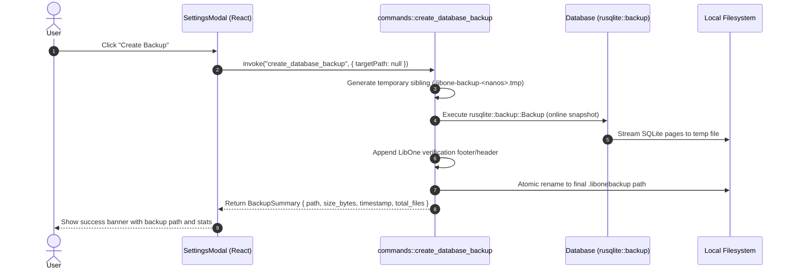

# LibOne Phase 4 Implementation Plan: Production Hardening, Diagnostics, Backup & Recovery, and Windows Distribution

**Objective**: Complete the final stabilization and release engineering phase of LibOne in `D:\LibOne`. Phase 4 transitions LibOne from a feature-complete local document organizer (Phases 1–3) into an exceptionally reliable, privacy-hardened, self-healing, recoverable, thoroughly tested, and packaged Windows desktop application ready for general distribution.

---

## 1. Architectural Guardrails & Strict Invariants

All fundamental LibOne principles established in Phases 1, 2, and 3 remain absolute and non-negotiable throughout Phase 4:

1. **100% Offline & Local-First**: Zero cloud APIs, telemetry, network tracking, analytics beacons, user accounts, license servers, or external services. No background outbound requests of any kind.
2. **Zero Modification to Original Files**: LibOne operates strictly in read-only mode over user document files. It never modifies, writes, renames, moves, or deletes any original file on disk.
3. **No Automatic File Operations**: All cleanup, backup, restore, or diagnostic actions operate solely on LibOne's internal metadata database or require explicit user confirmation.
4. **Metadata-Only Processing**: Backups, integrity checks, exports, and diagnostics inspect only SQLite tables and filesystem metadata (paths, sizes, timestamps, existence, permissions). Document file contents are never read, indexed, or stored.
5. **No Secrets or Tokens**: No API keys, credentials, machine identifiers, or personal tokens exist or will be committed to the repository.
6. **Preservation of Existing Behaviors**: All Phase 1 (scanning, watching, NTFS identity, search, export v1.0.0), Phase 2 (collections, tags, notes, export v1.1.0), and Phase 3 (suggestions, duplicate groups, relationships, local AI provider interface, export v1.2.0) behaviors remain completely intact.

---

## 2. Phase 4 Scope Overview & Milestones

```mermaid
flowchart TD
    subgraph M1["Milestone 1: Privacy & Security Hardening"]
        A1["Dependency & Outbound Network Audit"]
        A2["Strict Local Content Security Policy (CSP)"]
        A3["Path Validation & Shell Boundary Audit"]
        A4["Git & Secret Exposure Verification"]
    end

    subgraph M2["Milestone 2: Database Backup & Point-in-Time Restore"]
        B1["SQLite Online Backup API Engine"]
        B2[".libonebackup File Format with Header & Checksum"]
        B3["Pre-Restore Safety Snapshot & Rollback"]
        B4["Settings UI Backup & Restore Controls"]
    end

    subgraph M3["Milestone 3: Integrity Checks & Health Diagnostics"]
        C1["SQLite PRAGMA Integrity & Foreign Key Engine"]
        C2["Referential Consistency Audit (Phases 1–3)"]
        C3["Missing-File & Accessibility Diagnostic Scan"]
        C4["Database Health Dashboard & Report Card UI"]
    end

    subgraph M4["Milestone 4: Crash-Safe Durability & Self-Healing"]
        D1["Write-Ahead Logging (WAL) & Normal Sync"]
        D2["Bootstrap Recovery & Stale Temp Cleanup"]
        D3["Window Close Graceful Flush & Checkpoint"]
    end

    subgraph M5["Milestone 5: Windows Packaging & Release Engineering"]
        E1["Tauri v2 NSIS & MSI Installer Bundling"]
        E2["Release Profile (LTO, Opt-level 3, Strip)"]
        E3["Windows Icon Suite & Manifest Verification"]
    end

    subgraph M6["Milestone 6: Release Documentation & Verification"]
        F1["User Guide & Installation Manual"]
        F2["Security & Privacy Audit Document"]
        F3["Release Notes & Limitations Update"]
        F4["End-to-End Automated & Manual Test Suites"]
    end

    M1 --> M2 --> M3 --> M4 --> M5 --> M6
```



---

## 3. Milestone 1: Privacy & Security Hardening

### 3.1 Dependency & Network Surface Audit
- **Audit Target**: `src-tauri/Cargo.toml` and `package.json`.
- **Requirements**:
  - Verify that neither `reqwest`, `hyper`, `curl`, `socket`, `tokio-net`, nor any networking library is present in dependencies.
  - Verify `index.html` has no external CDN stylesheets, Google Fonts, remote script tags, or analytics beacons. All assets must bundle locally from `/dist`.
  - Add an automated unit test `test_zero_network_dependencies_and_no_remote_hosts` that parses `Cargo.lock` and `package.json` to ensure zero remote networking capabilities exist.

### 3.2 Content Security Policy (CSP) Lockdown
- **Audit Target**: `src-tauri/tauri.conf.json`.
- **Current State**: `"security": { "csp": null }`.
- **Target Implementation**: Lock down to a strict local-only Content Security Policy:
  ```json
  "security": {
    "csp": "default-src 'self'; script-src 'self'; style-src 'self' 'unsafe-inline'; img-src 'self' data: asset:; connect-src 'self' ipc: http://ipc.localhost; font-src 'self'; media-src 'none'; object-src 'none'; form-action 'none'; frame-ancestors 'none';"
  }
  ```
- **Guarantees**: Browser rendering engine is prevented from making outbound network requests even if malicious input were injected.

### 3.3 Path Authorization & Execution Boundary Audit
- **Audit Target**: `src-tauri/src/commands.rs` and `src-tauri/src/validate.rs`.
- **Guarantees**:
  - `open_file_in_default_app` and `show_file_in_folder`: Continue to strictly require validation against `validate_file_for_access`, asserting the file is indexed, within an active enabled scan root, and canonical on disk.
  - File execution uses direct Win32 `ShellExecuteW` (no `cmd.exe` or PowerShell command strings) with a hardcoded `"open"` verb.
  - Explorer reveal uses direct `explorer.exe` process execution with arguments separated in argv (`/select,<path>`).

### 3.4 Git & Repository Cleanliness
- Verify that tracked files contain no SQLite databases (`*.db`, `*.db-wal`, `*.db-shm`), no logs, no temporary files (`*.tmp`), and no build caches.
- Assert that `.gitignore` comprehensively excludes all distribution bundles (`src-tauri/target/release/bundle/`).

---

## 4. Milestone 2: Local Database Backup & Restore Engine

### 4.1 Backup Architecture
LibOne must provide users a reliable, 1-click method to back up their entire metadata library (scan roots, indexed files, collections, tags, notes, suggestions, and duplicate groups) without closing the application or stopping background watchers.



### 4.2 `.libonebackup` Archive Specification
To distinguish LibOne backups from arbitrary SQLite files and prevent importing corrupted or foreign databases, backups will use a dedicated format:
- **File Extension**: `.libonebackup` (or standard `.db` if explicitly chosen by user).
- **Online Backup Engine**: `rusqlite::backup::Backup::new(&src_conn, &mut dest_conn)` copying all database pages consistently while active read transactions continue.
- **Verification Header**: A dedicated internal table `libone_backup_manifest`:
  ```sql
  CREATE TABLE IF NOT EXISTS libone_backup_manifest (
      backup_version INTEGER NOT NULL,
      schema_version INTEGER NOT NULL,
      created_at TEXT NOT NULL,
      source_app_version TEXT NOT NULL,
      total_files_indexed INTEGER NOT NULL,
      content_checksum TEXT NOT NULL
  );
  ```

### 4.3 Safe Restore Pipeline with Pre-Restore Safety Copy
Restoring a database is a sensitive operation. LibOne must protect the user against power loss, accidental restoration of corrupted files, or regret:

1. **Pre-Restore Validation**:
   - Inspect the candidate backup file before touching `libone.db`.
   - Run `PRAGMA integrity_check` and `PRAGMA schema_version` on the candidate file.
   - Assert `schema_version <= SCHEMA_VERSION` (version 4) and verify table structure.
2. **Automatic Safety Snapshot**:
   - Automatically copy the active `libone.db` to `%APPDATA%\com.libone.app\libone.db.pre-restore-<timestamp>` before overwriting.
3. **Atomic Replacement**:
   - Close active SQLite connection pool.
   - Atomically replace `libone.db` and remove stale `-wal` and `-shm` companion files.
   - Reopen database connection and re-run migrations if restoring an older schema.
4. **State Refresh**:
   - Broadcast `library-restored` event to frontend so all views (files, collections, tags, suggestions) immediately refresh.

### 4.4 New Tauri Commands
- `create_database_backup(target_file_path: Option<String>) -> Result<BackupResult, String>`
- `restore_database_backup(backup_file_path: String) -> Result<RestoreResult, String>`
- `list_available_backups() -> Result<Vec<BackupFileInfo>, String>`

---

## 5. Milestone 3: Integrity Checks & Health Diagnostics

### 5.1 Deep SQLite PRAGMA Checks
The diagnostic engine will run internal SQLite health commands:
1. `PRAGMA integrity_check`: Validates B-trees, page allocation, cell offsets, index coherence.
2. `PRAGMA foreign_key_check`: Scans all tables for orphan foreign keys (e.g., `file_collections` pointing to non-existent files or collections).
3. `PRAGMA freelist_count`: Inspects unused page count to determine database fragmentation.

### 5.2 Referential Integrity Validation Across Phases 1–3
Custom query routine verifying internal schema consistency:
- **Files without Roots**: Indexed files whose `scan_root_id` does not exist in `scan_roots`.
- **Dangling Links**: `file_collections`, `file_tags`, and `file_notes` referencing missing file IDs.
- **Dangling Suggestions**: `suggestion_files` referencing missing suggestion IDs or file IDs.
- **Dangling Duplicate Groups**: `duplicate_group_files` referencing missing group IDs or file IDs.

### 5.3 Missing-File & Accessibility Diagnostic Scan
An on-demand, non-blocking disk audit:
- Iterates over all active indexed files in the library.
- Tests `std::fs::metadata(&path)` on the host filesystem:
  - **Accessible**: File exists on disk, size matches metadata.
  - **Size Modified**: File exists on disk, but byte size has changed.
  - **Missing**: File no longer exists on disk.
  - **Inaccessible**: File exists but OS denies read access (`permission_denied` / exclusive lock).
  - **Scan Root Offline**: Containing root drive is unmounted/disabled.
- **Invariant**: Strictly tests filesystem metadata only. Never opens file bodies or reads contents.

### 5.4 Database Health Dashboard (Settings Modal)
Add a **"Database Health & Diagnostics"** tab in `SettingsModal.tsx`:
- **Integrity Status**: Healthy (green pill) / Warnings Found (yellow pill) / Corrupt (red pill).
- **Health Metrics Table**:
  - Total Indexed Records
  - File Records Verified on Disk
  - Missing Files Detected
  - Inaccessible / Locked Files
  - Database File Size on Disk (KB/MB)
  - WAL Journal Size (KB)
  - SQLite Page Count & Freelist Count
- **Actions**:
  - `Run Integrity Check`: Triggers SQLite and foreign key verification.
  - `Verify Disk Files`: Runs on-demand missing-file verification.
  - `Optimize & Vacuum`: Runs `PRAGMA vacuum;` and `PRAGMA optimize;` to reclaim unused disk space.

---

## 6. Milestone 4: Crash-Safe Durability & Self-Healing Startup Recovery

### 6.1 Write-Ahead Logging (WAL) Configuration
To ensure maximum concurrency and crash durability, configure SQLite on every connection:
```sql
PRAGMA journal_mode = WAL;
PRAGMA synchronous = NORMAL;
PRAGMA foreign_keys = ON;
PRAGMA busy_timeout = 5000;
```
- **Benefits**:
  - Readers never block writers, and writers never block readers.
  - In the event of a sudden OS crash or power cutoff, uncommitted transactions are cleanly rolled back from the `-wal` file on next launch without corrupting the main `.db`.
  - `synchronous = NORMAL` in WAL mode is completely crash-safe on NTFS.

### 6.2 Bootstrap Self-Healing Pipeline
On app initialization in `src-tauri/src/lib.rs` and `db.rs`:
1. **Quick Check**: Execute `PRAGMA quick_check;` on the primary database file.
2. **Automatic WAL Recovery**: Rusqlite automatically recovers uncheckpointed WAL frames on opening.
3. **Stale Temporary File Sweep**:
   - Clean up leftover temporary files in target directories:
     - `.libone-export-*.tmp`
     - `.libone-backup-*.tmp`
     - `.libone-scan-*.tmp`
4. **Active Scan Reset**: If the app terminated while a scan was in progress (`last_scan_status = 'running'`), reset state to `'cancelled'` or `'interrupted'` on startup so scan buttons and indicators never stay frozen.

### 6.3 Graceful Window Close & WAL Checkpoint
- Register Tauri window event listener for `tauri::WindowEvent::CloseRequested`.
- Signal background watcher threads to stop monitoring.
- Cancel any ongoing scan loop.
- Execute `PRAGMA wal_checkpoint(TRUNCATE);` to flush WAL frames into `libone.db` before process exit.

---

## 7. Milestone 5: Windows Packaging & Release Configuration

### 7.1 Tauri Bundle Configuration (`tauri.conf.json`)
Upgrade bundling configuration to production standards:
```json
{
  "productName": "LibOne",
  "version": "1.0.0",
  "identifier": "com.libone.app",
  "bundle": {
    "active": true,
    "targets": ["nsis", "msi"],
    "icon": [
      "icons/32x32.png",
      "icons/128x128.png",
      "icons/128x128@2x.png",
      "icons/icon.ico"
    ],
    "windows": {
      "certificateThumbprint": null,
      "digestAlgorithm": "sha256",
      "timestampUrl": ""
    }
  }
}
```

### 7.2 NSIS Installer Settings (`bundle.windows.nsis`)
- **Install Mode**: `perMachine` (optional per-user fallback).
- **Customization**:
  - Displays LibOne product logo, name, and clear license summary.
  - Creates Desktop shortcut and Start Menu folder.
  - Option to launch LibOne on setup completion.
- **Uninstaller Safety Guarantee**:
  - Default uninstallation leaves user library metadata (`%APPDATA%\com.libone.app\libone.db`) intact.
  - Explicit checkbox: *"Also remove local database and cached library metadata"* (default: unchecked).
  - Uninstaller **never** touches user document folders or original files.

### 7.3 Release Profile & Binary Size Optimization
In `src-tauri/Cargo.toml`:
```toml
[profile.release]
codegen-units = 1
lto = true
opt-level = 3
panic = "abort"
strip = true
```
- In `package.json`: Vite production build with terser/esbuild minification and chunk splitting.

---

## 8. Milestone 6: Release Documentation Suite

Four dedicated documentation assets will be created in the repository root:

1. **`USER_GUIDE.md`**:
   - Complete illustrated manual for end users on Windows 10/11.
   - Adding and scanning folders.
   - Managing collections, smart tags, and private notes.
   - Reviewing suggestions, duplicate groups, and version relationships.
   - Creating backups, restoring snapshots, and exporting JSON metadata.
   - Troubleshooting common questions (missing files, disabled roots, external drives).

2. **`SECURITY_AND_PRIVACY.md`**:
   - Comprehensive technical declaration of LibOne's security boundaries.
   - Verifiable claims: zero telemetry, zero analytics, zero network sockets, local SQLite storage.
   - Path traversal defense, read-only guarantees, and non-shell execution architecture.

3. **`RELEASE_NOTES_v1.0.md`**:
   - Complete feature summary across Phases 1, 2, 3, and 4.
   - System requirements: Windows 10/11 64-bit, NTFS recommended, 200 MB disk space.
   - Known limitations and supported file types.

4. **Updated `README.md`, `ARCHITECTURE.md`, and `KNOWN_LIMITATIONS.md`**:
   - Reflect Phase 4 production readiness, backup/restore architecture, and diagnostic tooling.

---

## 9. Comprehensive Testing Strategy

### 9.1 Automated Rust Unit & Integration Tests (`src-tauri/src/`)
Implement in `src-tauri/src/commands.rs` and `db.rs`:
- `test_database_backup_online_snapshot_produces_valid_database`: Proves backup captures all records while database is open.
- `test_database_restore_replaces_state_and_preserves_safety_copy`: Proves restoration succeeds and creates pre-restore copy.
- `test_database_restore_rejects_corrupted_file`: Proves corrupted or truncated file cannot overwrite active database.
- `test_sqlite_wal_mode_and_concurrency`: Proves WAL journal mode is active and concurrent readers do not block.
- `test_integrity_check_detects_clean_database`: Proves PRAGMA integrity_check passes on valid schema.
- `test_foreign_key_check_detects_violations`: Proves foreign key violations are reported if dangling records exist.
- `test_missing_file_diagnostic_accurately_detects_status`: Proves diagnostic correctly identifies existing vs deleted files without touching contents.
- `test_startup_recovery_cleans_stale_temporary_files`: Proves `.tmp` files from interrupted exports or backups are purged on bootstrap.
- `test_uninterrupted_phase1_to_phase3_regressions`: Asserts all existing 77 tests continue to pass with 0 regressions.

### 9.2 Automated Frontend Tests (`src/`)
Implement in `src/components/`:
- `SettingsModal.test.tsx`:
  - Verifies Backup and Restore button clicks call corresponding API functions.
  - Verifies confirmation dialogs appear before initiating a restore.
  - Verifies diagnostics tab displays health status, page count, and database size.
- `DiagnosticsSection.test.tsx`:
  - Verifies "Run Integrity Check" triggers analysis and renders healthy/warning badges.
  - Verifies "Verify Disk Files" updates missing-file counts.

### 9.3 Manual Release Acceptance Test Plan (`PHASE_4_MANUAL_TEST_PLAN.md`)
Create a reproducible 12-case Windows test protocol:
- **TC-P4-01**: Clean installation via NSIS setup executable on Windows 11.
- **TC-P4-02**: First launch, AppData directory creation, and WAL journal initialization.
- **TC-P4-03**: Large folder scan stress test (10,000+ files) verifying memory stability.
- **TC-P4-04**: Online backup generation while active scan root is watching.
- **TC-P4-05**: Database restore from `.libonebackup` file verifying complete data restoration.
- **TC-P4-06**: Corrupted backup rejection test (tampered byte array safely rejected).
- **TC-P4-07**: Missing-file diagnostic scan with physical file deletion outside the app.
- **TC-P4-08**: Database integrity verification via Settings modal.
- **TC-P4-09**: Sudden application termination test (Kill via Task Manager during scan) verifying clean restart.
- **TC-P4-10**: External USB volume unplug resilience during active watch.
- **TC-P4-11**: Export v1.2.0 compatibility check.
- **TC-P4-12**: Uninstallation test verifying user files and optional database retention.

---

## 10. Phase 4 Task Breakdown & Execution Order

| Task ID | Component | Task Description | Dependencies |
|---|---|---|---|
| **P4-T01** | Security | Lock down Content Security Policy (CSP) in `tauri.conf.json` | None |
| **P4-T02** | Security | Add automated tests for zero network dependencies and path boundary checks | P4-T01 |
| **P4-T03** | Backend | Configure SQLite WAL mode, normal synchronous, busy timeout in `db.rs` | None |
| **P4-T04** | Backend | Implement `create_database_backup` using `rusqlite::backup` with atomic temp write | P4-T03 |
| **P4-T05** | Backend | Implement `restore_database_backup` with pre-restore safety copy & validation | P4-T04 |
| **P4-T06** | Backend | Implement integrity checks (`PRAGMA integrity_check`, `foreign_key_check`) in `db.rs` | P4-T03 |
| **P4-T07** | Backend | Implement missing-file diagnostic scan and health metrics calculation | P4-T06 |
| **P4-T08** | Backend | Implement startup self-healing (temp cleanup, interrupted scan state reset) in `lib.rs` | P4-T03 |
| **P4-T09** | Frontend | Add TypeScript types and API client wrappers for backup, restore, diagnostics | P4-T04..07 |
| **P4-T10** | Frontend | Update `SettingsModal.tsx` with Backup/Restore controls and Diagnostics Card | P4-T09 |
| **P4-T11** | Packaging | Configure NSIS and MSI bundling parameters in `tauri.conf.json` | None |
| **P4-T12** | Documentation | Write `USER_GUIDE.md`, `SECURITY_AND_PRIVACY.md`, `RELEASE_NOTES_v1.0.md` | P4-T10 |
| **P4-T13** | Documentation | Write `PHASE_4_MANUAL_TEST_PLAN.md` with step-by-step verification protocol | P4-T12 |
| **P4-T14** | Verification | Run full automated Rust tests, Vitest suites, TypeScript check, and Vite build | All |

---

## 11. Acceptance Criteria & Definition of Done

Phase 4 will be considered complete when all of the following criteria are satisfied:

1. **Backup / Restore Verified**:
   - User can generate a complete point-in-time `.libonebackup` file with 1 click.
   - User can restore a valid `.libonebackup` file, fully restoring scan roots, files, collections, tags, notes, suggestions, and duplicate groups.
   - An automatic safety copy (`libone.db.pre-restore-*`) is always created before restoration.
   - Attempting to restore a corrupted, invalid, or foreign file is safely rejected before altering the active database.
2. **Integrity & Diagnostics Operational**:
   - `PRAGMA integrity_check` and foreign key verification report database health directly in the UI.
   - Missing-file diagnostic scan accurately enumerates missing and inaccessible files without reading document bodies.
3. **Crash Durability & Self-Healing Active**:
   - SQLite operates with WAL journaling and normal synchronization.
   - Stale temporary files (`.tmp`) left from terminated sessions are cleaned up automatically on bootstrap.
   - Interrupted scans reset safely to non-blocking statuses on restart.
4. **Security & Privacy Locked Down**:
   - Strict local-only CSP is enforced in `tauri.conf.json`.
   - Zero network dependencies, zero telemetry, zero remote requests verified by automated test.
   - Original document files remain strictly read-only and untouched.
5. **Windows Packaging Configured**:
   - NSIS installer configuration defined with custom install path, shortcuts, and safe uninstaller options.
   - Release profile optimized for compact binary size and execution speed.
6. **Documentation Complete**:
   - `USER_GUIDE.md`, `SECURITY_AND_PRIVACY.md`, `RELEASE_NOTES_v1.0.md`, and `PHASE_4_MANUAL_TEST_PLAN.md` authored and indexed.
7. **Quality Gate**:
   - `cargo test` passes 100% of Rust tests with 0 failures and 0 warnings.
   - `npx vitest run` passes 100% of frontend tests.
   - `npx tsc --noEmit` and `npm run build` pass with 0 errors.
